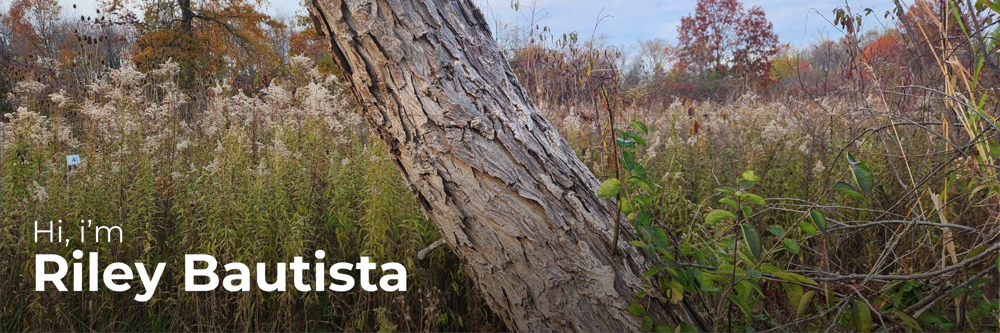

## 🔧 | Languages

## 📚 | Tools

## ✨ | Stats About Me 

## 🪨| My #30NitesOfCode Pet
  [Check out my progress!](https://www.codedex.io/@RileyBautista/30-nites-of-code)  
  
  
## 📛 | Holopin Badges

## 👥 | Lets Connect!
Email Me at rbautista@duck.com \
or via [LinkedIn](https://www.linkedin.com/in/riley-bautista/)
